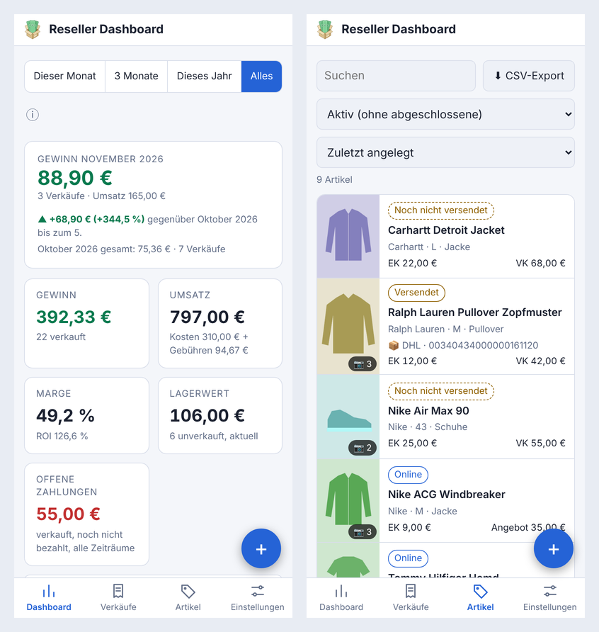
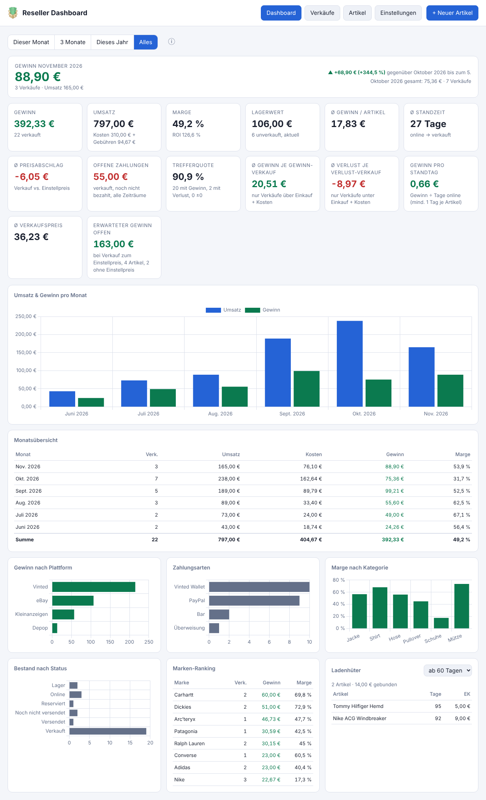
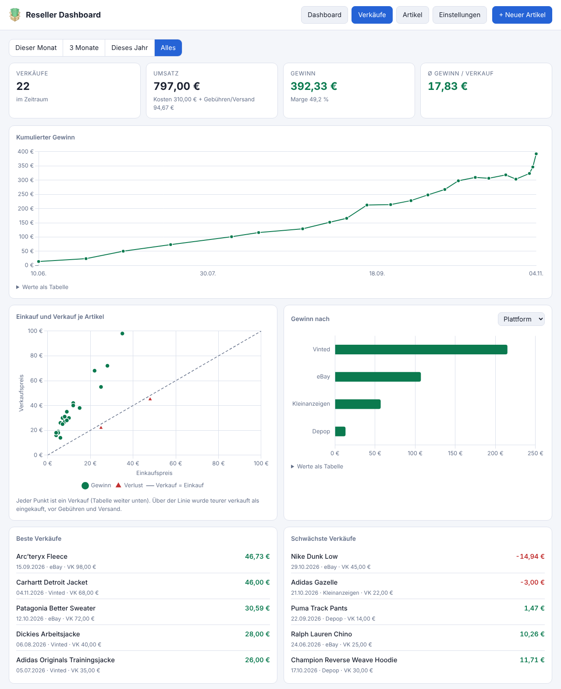
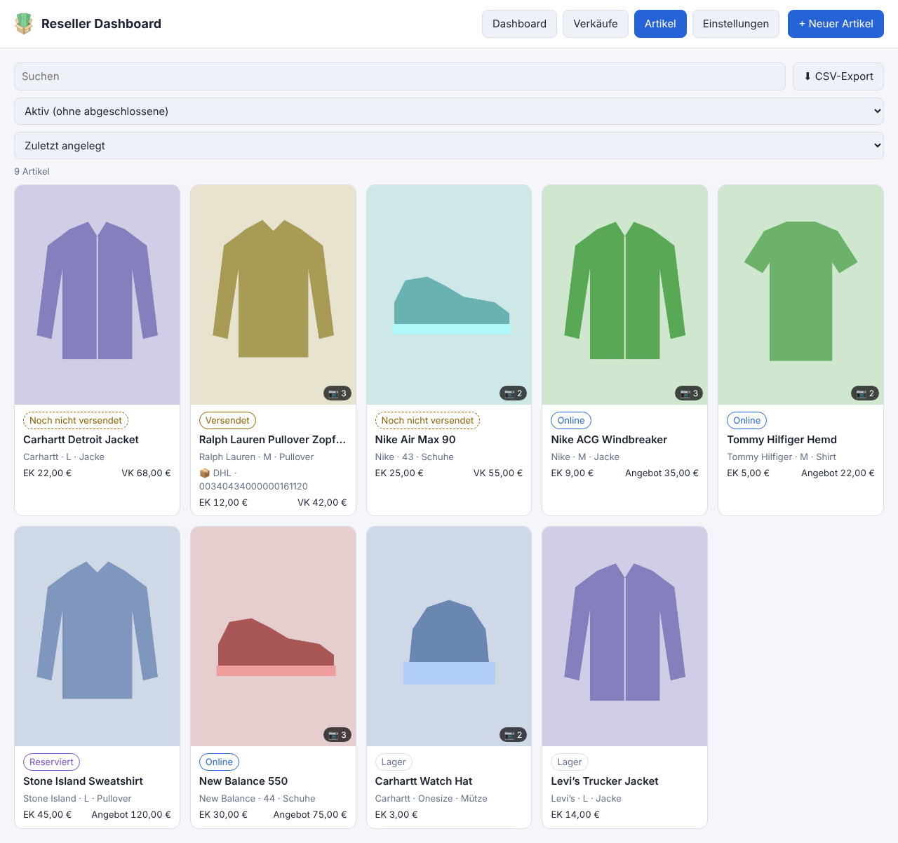

<p align="center">
  
</p>

<h1 align="center">Reseller-Dashboard</h1>

<p align="center"><a href="README.md">English</a> · <b>Deutsch</b></p>

<p align="center">
  Artikelverwaltung und Finanz-Dashboard für Reseller,<br>
  vom Einkauf über Fotos und Versand bis zum Gewinn pro Monat.
</p>

<p align="center">
  <a href="https://github.com/MySquat516/Reseller-Dashboard/actions/workflows/test.yml"></a>
  <a href="https://github.com/MySquat516/Reseller-Dashboard/actions/workflows/docker.yml"></a>
  <a href="https://github.com/MySquat516/Reseller-Dashboard/actions/workflows/ios.yml"></a>
</p>

<p align="center">
  
</p>

---

Wer nebenbei Klamotten, Sneaker & Co. weiterverkauft, verliert schnell den Überblick: Was liegt noch im Lager,
was ist verkauft, aber noch nicht verschickt, und was bleibt nach Gebühren und Porto wirklich hängen?
Das Reseller-Dashboard beantwortet das an einem Ort. Es läuft im eigenen Homelab, die Daten bleiben bei dir.

## Was es kann

- **Artikel mit allem Drum und Dran:** Titel, Beschreibung, Größe, Kategorie, Marke, Zustand, Notizen und
  bis zu 60 Fotos pro Artikel (Drag-and-drop, Einfügen per Strg+V, am Handy direkt aus der Kamera)
- **Status-Ablauf:** Lager → Online → Reserviert → Noch nicht versendet → Versendet → Verkauft
- **Verkauf und Versand:** Plattform, Käufer, Zahlungsart und -status, Gebühren, Versandkosten,
  Sendungsnummer mit Tracking-Link und Versandvorlagen
- **Dashboard:** Gewinn des Monats mit Vormonatsvergleich, Umsatz, Marge, ROI, Standzeit, Lagerwert,
  offene Zahlungen, Ladenhüter und Auswertungen nach Plattform, Zahlungsart, Kategorie und Marke
- **Verkäufe-Ansicht:** sortierbare Tabelle, beste und schwächste Verkäufe, kumulierter Gewinn und
  Einkauf gegen Verkauf als Diagramm
- **CSV-Export und -Import:** Excel-tauglich, mit Vorschau, Fehlerprüfung und Duplikat-Erkennung
- **Backups:** vollständiges Backup per Klick, Wiederherstellung mit automatischer Sicherheitskopie und
  tägliche automatische Sicherung
- **Fürs Handy gemacht:** läuft als App auf dem Homescreen, dazu gibt es eine native iOS-App (im Aufbau)
- **Optionaler Passwortschutz** mit Face-ID-tauglichem Login am iPhone

## Screenshots

Alle Screenshots zeigen Beispieldaten, keine echten Artikel und keine echten Fotos.

**Dashboard:** Monatsgewinn, Kennzahlen, Monatsübersicht, Auswertungen und Ladenhüter



<details>
<summary><b>Verkäufe und Artikel</b></summary>

**Verkäufe:** kumulierter Gewinn, Einkauf gegen Verkauf je Artikel, Gewinn nach Gruppe, beste und schwächste
Verkäufe. Darunter folgt die sortierbare Tabelle aller Verkäufe.



**Artikel:** Liste mit Status, Fotos, Suche, Filter, Sortierung und CSV-Export.



</details>

## Schnellstart

GitHub baut bei jedem Push auf `main` ein fertiges Image für `amd64` und `arm64`:
`ghcr.io/mysquat516/reseller-dashboard:latest`. Auf dem Server brauchst du nur die
[`docker-compose.yml`](docker-compose.yml):

```bash
docker compose pull      # neues Image holen
docker compose up -d     # starten oder aktualisieren
```

Danach ist das Dashboard unter `http://<server>:3000` erreichbar. Einen anderen Port wählst du beim Start,
zum Beispiel mit `PORT=8080 docker compose up -d`. Ein Update besteht nur aus diesen beiden Befehlen.
Neue Datenbankspalten werden beim Start automatisch ergänzt.

> **Privates Paket?** Ob sich der Server anmelden muss, hängt von der Sichtbarkeit des Pakets ab
> (GitHub → *Packages → reseller-dashboard → Package settings*). Ist es privat, einmal
> `docker login ghcr.io -u <github-benutzer>` ausführen. Als Passwort dient ein Personal Access Token
> (classic) mit dem Recht `read:packages`.

Pro Build gibt es zusätzlich den Tag `sha-<commit>`, damit sich ein älterer Stand wiederherstellen lässt
(`image: …:sha-abc1234`).

<details>
<summary><b>Selbst bauen oder ohne Docker starten</b></summary>

**Selbst bauen:**

```bash
docker compose up -d --build
```

Der Build läuft mit `network: host` (siehe `docker-compose.yml`), damit `npm ci` auch bei DNS-Problemen im
Heimnetz funktioniert. Zum Aktualisieren den neuen Stand holen (`git pull` oder neues ZIP entpacken, den Ordner
`data` behalten) und `docker compose up -d --build` ausführen.

**Ohne Docker:** Voraussetzung ist Node.js 20 oder 22 (darauf laufen die Tests). Für Node 24 gibt es für die
eingesetzte better-sqlite3-Version keine fertigen Pakete. `npm install` müsste es dann selbst kompilieren und
bräuchte dafür Python, make und einen C++-Compiler.

```bash
npm install
npm start      # http://localhost:3000, Daten landen in ./data
npm test       # automatische Tests
```

</details>

## Konfiguration

Die meisten Einstellungen machst du im Tab **Einstellungen**: Standard-Zeitraum, Ladenhüter-Grenze
(7 bis 365 Tage), optionales Monatsziel und Versandvorlagen. Sie gelten auf allen Geräten.
Für den Container gibt es in der `docker-compose.yml` unter `environment:` außerdem diese Variablen:

| Variable | Standard | Bedeutung |
|---|---|---|
| `TZ` | `Europe/Berlin` | Zeitzone |
| `APP_PASSWORD` | leer | schaltet den Passwortschutz ein |
| `APP_USER` | `admin` | Benutzername für den Login |
| `SESSION_DAYS` | `90` | wie lange eine Anmeldung gilt |
| `SESSION_SECRET` | zufällig | Schlüssel für Anmeldungen (Standard: Wert in `data/session-secret`) |
| `BACKUP_AUTO` | an | `0` schaltet die tägliche Sicherung aus |
| `BACKUP_KEEP` | `14` | wie viele Tage automatische Sicherungen bleiben |
| `BACKUP_DIR` | `<Datenordner>/backups` | anderer Ort für die Sicherungen, zum Beispiel eine zweite Platte |
| `MAX_RESTORE_MB` | `4096` | größte erlaubte Datei beim Einspielen eines Backups |

Alle Daten (Datenbank `reseller.db` und Bilder in `uploads/`) liegen im Ordner `./data`.

## Was zählt als Verkauf?

- **Reserviert** zählt noch nicht: Der Artikel gilt als unverkauft und bleibt im Lagerwert, aber nicht bei den Ladenhütern.
- Ab **Noch nicht versendet** (sowie Versendet und Verkauft) zählt ein Artikel mit eingetragenem Verkaufspreis
  als Verkauf und geht in Gewinn, Umsatz und Auswertungen ein, unabhängig vom Zahlungsstatus.
  Noch nicht bezahlte Verkäufe stehen zusätzlich bei „Offene Zahlungen“.
- Der Monat richtet sich nach „Verkauft am“, ersatzweise nach dem Anlegedatum.
- **Gewinn = Verkaufspreis − Einkaufspreis − Gebühren − Versandkosten**

## Im Detail

<details>
<summary><b>Alle Funktionen</b></summary>

- **Fotos:** bis zu 60 pro Artikel, Sortieren per Ziehen, Titelbild per Stern, Großansicht mit Pfeiltasten
  und Wischen. Große Fotos werden vor dem Upload im Browser auf maximal 1800 px verkleinert.
- **Artikelliste:** Sortierung (zuletzt/zuerst angelegt, Titel A–Z, Einkaufspreis, längste Standzeit; die Wahl
  bleibt gespeichert) und Suche mit mehreren Wörtern in beliebiger Reihenfolge über Titel, Marke, Größe, Kategorie,
  Zustand, Beschreibung, Plattform, Käufer, Notizen und Sendungsnummer. Die Trefferzahl steht über der Liste.
  Standardmäßig zeigt die Liste nur aktive Artikel, verkaufte sind über den Filter erreichbar.
- **Als Kopie anlegen:** legt eine Kopie samt Fotos an (praktisch für mehrere gleiche Teile). Status,
  Verkaufs- und Versanddaten bleiben leer.
- **Preise:** Einkauf, Einstellpreis, Verkaufspreis, Gebühren, Versandkosten und die zugehörigen Daten
- **Versand:** Anbieter, Sendungsnummer mit Tracking-Link (DHL, Deutsche Post, Hermes, DPD, GLS, UPS) und
  Versandvorlagen (Anbieter und Preis), die Anbieter und Versandkosten im Artikel ausfüllen
- **Dashboard** mit Zeitraum-Schalter (Dieser Monat, 3 Monate, Dieses Jahr, Alles): Gewinn, Umsatz, Marge, ROI,
  Standzeit, Preisabschlag und Auswertungen nach Plattform, Zahlungsart, Kategorie und Marke
- **Zusatzkennzahlen** für den gewählten Zeitraum: Trefferquote, Ø Gewinn je Gewinn- und Ø Verlust je
  Verlust-Verkauf, Gewinn pro Standtag, Ø Verkaufspreis und erwarteter Gewinn der offenen Posten
  (bei Verkauf zum Einstellpreis)
- **Monatskachel:** Gewinn des aktuellen Monats im Vergleich zum Vormonat bis zum gleichen Tag
- **Monatsübersicht** als Diagramm und Tabelle, auch für Monate ohne Verkäufe
- **Immer aktuell, unabhängig vom Zeitraum:** Lagerwert, Bestand, offene Zahlungen und Ladenhüter
  (Grenze einstellbar, Standard 60 Tage)
- **Verkäufe-Ansicht:** sortierbare Tabelle mit Summenzeile, Suche und Plattform-Filter, beste und schwächste
  Verkäufe. Ein Klick auf eine Zeile öffnet den Artikel.
- **Analyse-Diagramme:** kumulierter Gewinn über die Zeit, Streudiagramm Einkaufs- gegen Verkaufspreis je
  Artikel (Gewinn als Kreis, Verlust als Dreieck, Linie „Verkauf = Einkauf“) und Gewinn nach Plattform,
  Kategorie oder Marke. Zu Verlauf und Gruppen gibt es die Werte auch als Tabelle.
- **CSV-Export** (UTF-8, Semikolon, Dezimalkomma): alle, nur verkaufte oder nur unverkaufte Artikel,
  optional für einen Zeitraum (Verkaufs- oder Kaufdatum)
- **Formularhinweis**, wenn „Verkauft am“ vor „Online seit“ liegt

</details>

<details>
<summary><b>Backup und Wiederherstellung</b></summary>

Im Tab **Einstellungen → Daten & Backup**:

- **Backup herunterladen:** eine ZIP-Datei mit Datenbank und allen Fotos. Sie zeigt den Stand zum Zeitpunkt des
  Klicks und ist auch bei laufendem Betrieb konsistent.
- **Backup einspielen:** ersetzt alle Artikel, Fotos, Versandvorlagen und Einstellungen durch den Stand aus einer
  ZIP-Datei. Eine einzelne `.db`-Datei geht auch, zum Beispiel eine automatische Sicherung, dann bleiben die Fotos,
  wie sie sind. Vorher legt der Server automatisch eine **Sicherheitskopie des jetzigen Stands mit Fotos** an
  (`backups/pre-restore-….zip`, die letzten 2 bleiben). Ist die Datei ungültig oder beschädigt, wird nichts
  verändert. Backups aus älteren Versionen funktionieren ebenfalls.
- **Automatische Sicherung:** Einmal pro Tag wird die Datenbank (ohne Fotos) nach `backups/auto-JJJJ-MM-TT.db`
  kopiert, die letzten 14 Tage bleiben. Das schützt vor Bedienfehlern, aber nicht vor einem Festplattenausfall,
  weil der Ordner im selben Datenverzeichnis liegt. Lade deshalb ab und zu ein vollständiges Backup herunter
  oder sichere `./data` zusätzlich extern.

Wer `./data` von Hand kopiert, stoppt vorher den Container (`docker compose stop`). Die Datenbank läuft im
WAL-Modus, eine Kopie bei laufender App kann die letzten Änderungen verlieren oder unvollständig sein.

Der Container läuft aus Sicherheitsgründen nicht als root, sondern als Benutzer `node`. Beim ersten Start nach
einem Update setzt er den Besitzer von `./data` automatisch darauf, das kann bei vielen Fotos kurz dauern.
Ob die App gesund ist, zeigt `docker ps` (Status `healthy`), dafür fragt Docker `/healthz` ab.

</details>

<details>
<summary><b>Passwortschutz</b></summary>

Ohne `APP_PASSWORD` hat die App keinen Login. Betreibe sie dann nur im Heimnetz oder per VPN.
Zum Einschalten in der `docker-compose.yml` unter `environment:`:

```yaml
      APP_PASSWORD: ein-langes-passwort
      # APP_USER: admin          # Benutzername, Standard: admin
```

Danach zeigt jede Seite zuerst eine Anmeldeseite. Die Anmeldung gilt 90 Tage (Cookie bzw. Token), bis du dich
unter Einstellungen → Sicherheit abmeldest oder das Passwort änderst. Das meldet überall ab.

- **Face ID am iPhone:** Die Anmeldeseite ist ein normales Formular. Speicherst du die Zugangsdaten im
  iPhone-Passwortmanager, füllt Safari sie nach einer Face-ID-Prüfung aus.
- Nach 5 falschen Versuchen sperrt der Server die Anmeldung für 5 Minuten. Das Passwort wird zeitkonstant verglichen.
- Ohne HTTPS laufen Passwort und Cookie im Klartext durchs Netz (im WireGuard-VPN ist das verschlüsselt).
  Hinter einem HTTPS-Proxy bekommt das Cookie automatisch das `Secure`-Flag (Header `X-Forwarded-Proto`).
- Öffentlich bleiben nur die Anmeldeseite, `/healthz`, das Logo und die Icons.
- Für Skripte und Apps: `POST /api/login` mit `{"username": …, "password": …}` liefert ein Cookie und ein Token,
  das als `Authorization: Bearer <token>` mitgeschickt werden kann.
- Die iOS-App kann sich noch nicht anmelden (geplant zusammen mit der Face-ID-Sperre). Schalte den
  Passwortschutz bis dahin nur ein, wenn du die iOS-App nicht nutzt.

</details>

<details>
<summary><b>Als App auf dem Handy nutzen</b></summary>

Die Weboberfläche ist für Handys ausgelegt und lässt sich wie eine App auf den Homescreen legen:

- **iPhone (Safari):** Teilen-Symbol → „Zum Home-Bildschirm“. Danach öffnet sich die App im Vollbild.
- **Android (Chrome):** Menü → „Zum Startbildschirm hinzufügen“. Als vollständig installierte App bietet
  Chrome das nur über HTTPS an.

Das funktioniert auch über reines HTTP (`http://<server-ip>:3000`). Einen Offline-Modus gibt es nicht, die App
braucht immer eine Verbindung zum Server. Von unterwegs verbindest du dich erst per VPN (z. B. WireGuard) ins
Heimnetz und öffnest dann dieselbe Adresse.

**iOS-App:** Im Ordner [`ios/`](ios/README.md) liegt eine native SwiftUI-App für iPhone und iPad, die dieselbe API
nutzt. Die Daten bleiben auf dem Server. Bisher gibt es die Artikelliste mit Suche und Filter sowie Anlegen,
Bearbeiten und Löschen. Fotos, Dashboard, Versandvorlagen und CSV folgen. Die Einrichtung mit Xcode und XcodeGen
steht in [`ios/README.md`](ios/README.md).

</details>

<details>
<summary><b>CSV-Import: Spalten und Formate</b></summary>

Zu finden unter **Einstellungen → „Artikel aus CSV importieren“**. Liest Listen aus Excel, Numbers oder Google
Sheets und den eigenen CSV-Export ein. Zuerst gibt es eine Vorschau mit Fehlern (Zeilennummer wie in Excel) und
Hinweisen, gespeichert wird erst nach Bestätigung. Trennzeichen (Semikolon, Komma, Tab) und Zeichensatz (UTF-8,
Excel-„ANSI“, UTF-16) werden automatisch erkannt. Mögliche Duplikate (gleicher Titel, Einkaufspreis und Kaufdatum
wie ein vorhandener Artikel) lassen sich überspringen, sodass sich dieselbe Datei gefahrlos zweimal einlesen lässt.
Eine Vorlage zum Ausfüllen gibt es per Button.

Die erste Zeile enthält die Spaltennamen, nur „Titel“ ist Pflicht. Groß- und Kleinschreibung, Bindestriche und
Umlaute spielen keine Rolle. Erkannt werden diese Spalten (mit gängigen Alternativen):

| Feld | Spaltenname (Alternativen) |
|---|---|
| Titel | Titel (Artikel, Bezeichnung, Name, Produkt) |
| Beschreibung, Größe, Kategorie, Marke, Zustand | gleichnamig (Größe: Size, Marke: Brand/Hersteller) |
| Status | Status: Lager, Online, Reserviert, Noch nicht versendet (zu versenden, gekauft), Versendet, Verkauft |
| Einkaufspreis, Gekauft am | EK, Kaufpreis · Kaufdatum, Einkaufsdatum |
| Einstellpreis, Online seit | Angebotspreis · Eingestellt am |
| Verkaufspreis, Verkauft am | VK, VK-Preis, Erlös · Verkaufsdatum |
| Plattform, Käufer, Zahlungsart, Zahlungsstatus | Marktplatz · Kunde · Zahlungsmethode · bezahlt/offen |
| Gebühren, Versandkosten | Provision · Porto, Versand |
| Versandanbieter, Sendungsnummer, Notizen | Carrier · Tracking · Notiz, Bemerkung |

Spalten wie ID, Gewinn und Bilder (aus dem eigenen Export) werden ignoriert, unbekannte Spalten ebenfalls.
Die Vorschau nennt sie.

- **Zahlen:** `12,50`, `12.5`, `1.234,56`, `1,234.56` und `12 €` sind möglich. Negative Beträge und mehr als
  zwei Nachkommastellen werden als Fehler gemeldet.
- **Datum:** `05.03.2026`, `5.3.26` und `2026-03-05` (auch mit Uhrzeit). Ungültige Tage wie der 31.02. sind Fehler.
- **Status leer:** Mit Verkaufspreis wird daraus „Verkauft“, sonst „Lager“.
- **Hinweise** (der Import klappt trotzdem): Status „Verkauft“ ohne Verkaufspreis (zählt nicht als Verkauf),
  Verkaufspreis ohne Verkaufsstatus, fehlendes Verkaufsdatum (es zählt dann der Importtag), Verkaufsdatum vor
  dem Kaufdatum.
- **Excel:** „Speichern unter“ → „CSV (Trennzeichen-getrennt)“ oder „CSV UTF-8“. Eine `.xlsx`-Datei kann nicht
  gelesen werden, die App sagt das dann.
- Der Import legt nur neue Artikel an und ändert keine vorhandenen. Fotos lassen sich nicht per CSV importieren.

</details>

<details>
<summary><b>API</b></summary>

| Methode | Pfad | Zweck |
|---|---|---|
| GET | `/api/items` | alle Artikel inkl. Bilder |
| GET | `/api/items/:id` | ein Artikel inkl. Bilder |
| POST | `/api/items` | Artikel anlegen |
| PUT | `/api/items/:id` | Artikel ändern |
| POST | `/api/items/:id/duplicate` | Kopie anlegen: Beschreibung, Einkaufsdaten, Einstellpreis, Notizen und Fotos werden übernommen, Status `lager`, Verkaufs- und Versanddaten leer; Antwort `{ id, images, skippedImages }` |
| DELETE | `/api/items/:id` | Artikel samt Bildern löschen |
| POST | `/api/items/:id/images` | Bilder hochladen (multipart, Feld `images`) |
| DELETE | `/api/images/:id` | einzelnes Bild löschen |
| PUT | `/api/items/:id/images/order` | Bildreihenfolge speichern |
| GET | `/api/stats?period=month\|3m\|year\|all&dead=7..365` | Kennzahlen fürs Dashboard (`dead` fehlt: Einstellung) |
| GET | `/api/sales?period=month\|3m\|year\|all` | alle Verkäufe im Zeitraum mit Gewinn, Marge und Standzeit |
| GET | `/api/export.csv` | Artikel als CSV; optional `?scope=all\|sold\|unsold&by=sold\|purchase&from=JJJJ-MM-TT&to=JJJJ-MM-TT` (Zeitraum inklusive, `by` ist das Datum, auf das er sich bezieht, Standard `sold`; ungültige Werte → 400) |
| GET/POST | `/api/shipping-presets` | Versandvorlagen auflisten / anlegen |
| PUT/DELETE | `/api/shipping-presets/:id` | Versandvorlage ändern / löschen |
| POST | `/api/login` | Anmelden (nur mit `APP_PASSWORD`): Cookie und Token |
| POST | `/api/logout` | Abmelden |
| GET | `/api/session` | `{auth, user}`: ist der Passwortschutz aktiv, und wer ist angemeldet |
| GET | `/api/backup` | vollständiges Backup (ZIP mit Datenbank und Fotos) herunterladen |
| POST | `/api/restore` | Backup einspielen (multipart, Feld `backup`: ZIP oder `.db`), ersetzt alle Daten |
| GET | `/api/backups` | Liste der Sicherungen im Ordner `backups` (automatisch und vor dem Einspielen) |
| GET | `/api/backups/:name` | eine dieser Sicherungen herunterladen |
| POST | `/api/import.csv` | Artikel aus CSV importieren; Body ist die Datei als Text (`Content-Type: text/csv`, max. 5 MB und 5000 Zeilen). `?dry=1` prüft nur und legt nichts an (Vorschau), `?skipDuplicates=0` importiert auch mögliche Duplikate. Antwort: erkannte Spalten, Anzahl gültig/Duplikate/Fehler, Fehler und Hinweise mit Zeilennummer, Beispielzeilen |
| GET/PUT | `/api/settings` | Einstellungen lesen / ändern (`default_period`, `dead_days`, `monthly_goal`; PUT nimmt auch einzelne Felder) |
| GET | `/healthz` | Healthcheck für Docker (`{ok: true}`), auch mit Passwortschutz ohne Anmeldung erreichbar |

</details>

<details>
<summary><b>Tests</b></summary>

`npm test` führt die automatischen Tests aus (`node --test`, keine zusätzlichen Pakete, etwa 12 Sekunden).

Die Server-Tests starten pro Testdatei den **echten Server** (`node server.js`) auf einem freien Port mit einem
leeren Temp-Datenordner und sprechen ihn über HTTP an. Deine echten Daten in `data/` werden dabei nie berührt.

| Datei | Prüft |
| --- | --- |
| `test/items.test.js` | Artikel (Anlegen, Ändern, Eingabeprüfung, kaputtes JSON), Kopieren, Versandvorlagen, Einstellungen, Foto-Upload (Dateikopf-Prüfung, Reihenfolge, Löschen) |
| `test/stats.test.js` | Kennzahlen und Verkaufsliste mit festem Datensatz: Gewinn, Zeiträume, Monatsliste, Ladenhüter, Verkauf ohne Datum oder Preis |
| `test/exportimport.test.js` | CSV-Export (Format, Auswahl, Formelschutz), CSV-Import über die API, Rundlauf Export → Import |
| `test/backup.test.js` | Backup-ZIP, Wiederherstellen (auch alte Versionen, kaputte und böswillige ZIPs), automatische Sicherung |
| `test/auth.test.js` | Passwortschutz: gesperrte Routen, Anmelden, Token, Ablauf, Bremse bei Fehlversuchen, Weiterleitungen |
| `test/csvimport.test.js` | Import-Logik einzeln (Zahlen, Datum, Trennzeichen, Zeichensätze) |
| `test/packaging.test.js` | Docker-Image enthält alle Server-Dateien, Abhängigkeiten, Skripte der Oberfläche ohne Namenskonflikte |

Hilfsfunktionen (Server starten, Testbilder, ZIP-Dateien) liegen in `testlib/`, nicht in `test/`, weil
`node --test` jede Datei in `test/` als Test ausführt. Die GitHub-Action `.github/workflows/test.yml` startet die
Tests bei jedem Push und Pull Request mit Node 20 (wie im Docker-Image) und Node 22.

Nicht automatisch getestet werden die Oberfläche im Browser (die wird von Hand geprüft) und die iOS-App
(eigener Workflow `ios.yml`).

</details>

## Aufbau

| Teil | Inhalt |
|---|---|
| `server.js` | Express-Server, API und Datenbank (SQLite über better-sqlite3) |
| `auth.js`, `backup.js`, `csvimport.js` | Passwortschutz, Backups, CSV-Import |
| `public/` | Oberfläche in Vanilla-JS mit Chart.js, Icons und Manifest für den Homescreen |
| `ios/` | native SwiftUI-App für iPhone und iPad |
| `test/`, `testlib/` | automatische Tests und Hilfsfunktionen |

---

<sub>Diese App wurde mit Hilfe von KI (Claude von Anthropic) entwickelt. Idee, Anforderungen und Tests kommen
vom Projektinhaber, der Code wurde KI-gestützt geschrieben. Bitte vor dem produktiven Einsatz selbst prüfen.</sub>
