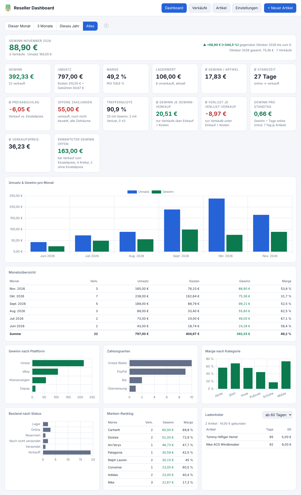
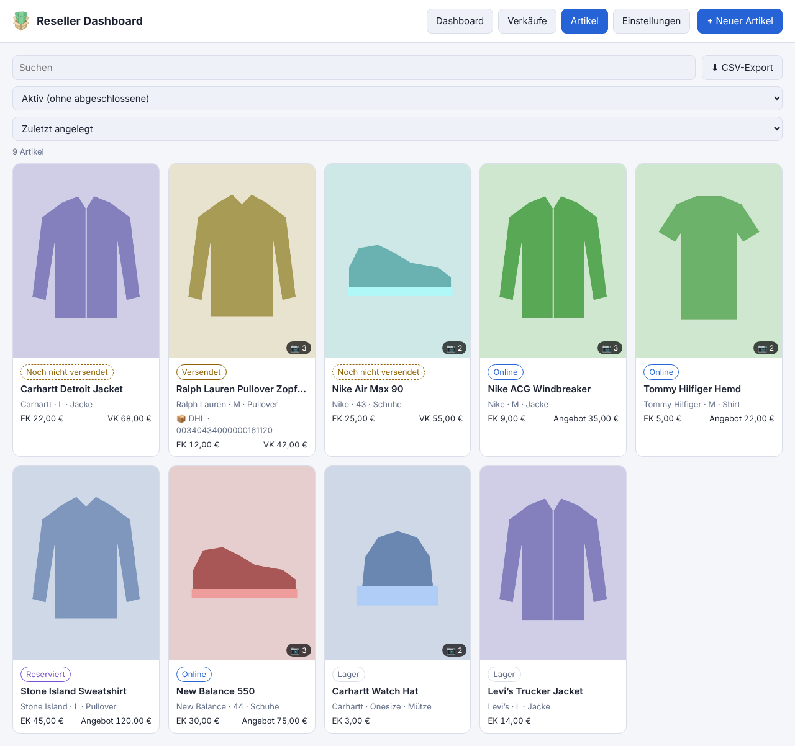

# Reseller Dashboard

Artikelverwaltung mit Bild-Upload und Finanz-Dashboard für Reseller.
Stack: Node.js, Express, SQLite (better-sqlite3), Chart.js, Vanilla-JS-Frontend.

> **Hinweis:** Diese App wurde mit Hilfe von KI (Claude von Anthropic) entwickelt.
> Idee, Anforderungen und Tests kommen vom Projektinhaber, der Code wurde KI-gestützt geschrieben.
> Bitte vor dem produktiven Einsatz selbst prüfen.

## Oberfläche

Beispieldaten, keine echten Artikel.





## Starten mit Docker

### Fertiges Image (empfohlen)

GitHub baut das Image bei jedem Push auf `main` automatisch (`.github/workflows/docker.yml`) und legt es
unter `ghcr.io/mysquat516/reseller-dashboard:latest` ab (für `amd64` und `arm64`). Auf dem Server wird dann
nichts mehr gebaut:

```bash
docker compose pull      # neues Image holen
docker compose up -d     # Container neu starten
```

Update = nur diese zwei Befehle, die Dateien müssen nicht mehr aktualisiert werden. Einzig die
`docker-compose.yml` braucht der Server einmalig.

**Zugriff auf das Image:** Ist das Repo privat, ist das Image es auch. Der Server meldet sich dann einmal an:

```bash
docker login ghcr.io -u <github-benutzername>
```

Als Passwort dient ein *Personal Access Token (classic)* mit dem Recht `read:packages`
(GitHub → Settings → Developer settings → Personal access tokens). Alternativ lässt sich das Paket auf GitHub
unter *Packages → reseller-dashboard → Package settings* auf „Public“ stellen, dann ist kein Login nötig
(der Code der App steckt dann allerdings im öffentlichen Image).

Das Image erscheint erst nach dem ersten Push auf `main`. Außerdem gibt es pro Build den Tag `sha-<commit>`,
damit sich ein älterer Stand wiederherstellen lässt (`image: …:sha-abc1234`).

### Selbst bauen

```bash
docker compose up -d --build
```

Danach erreichbar unter `http://<server>:3000`.

Der Build läuft mit `network: host` (siehe `docker-compose.yml`), damit `npm install` im Docker-Build
auch bei DNS-Problemen im Heimnetz funktioniert. Beim Selbstbauen wird das Image lokal aus dem `Dockerfile` erzeugt
und unter demselben Namen wie das fertige Image abgelegt.

**Update beim Selbstbauen:** neuen Stand holen (`git pull` oder neues ZIP entpacken, den Ordner `data` behalten) und
`docker compose up -d --build` ausführen. Neue Datenbankspalten werden beim Start automatisch ergänzt.

Alle Daten (Datenbank `reseller.db` und Bilder in `uploads/`) liegen im Ordner `./data`.
Backup = diesen Ordner kopieren, oder bequemer über die App (siehe unten).

### Backup und Wiederherstellung

Im Tab **Einstellungen → Daten & Backup**:

- **Backup herunterladen:** eine ZIP-Datei mit Datenbank und allen Fotos (Stand zum Klickzeitpunkt, auch bei laufendem Betrieb konsistent).
- **Backup einspielen:** ersetzt alle Artikel, Fotos, Versandvorlagen und Einstellungen durch den Stand aus einer ZIP-Datei
  (oder aus einer einzelnen `.db`-Datei, zum Beispiel einer automatischen Sicherung; Fotos bleiben dann, wie sie sind).
  Vorher legt der Server automatisch eine **Sicherheitskopie des jetzigen Stands mit Fotos** an (`backups/pre-restore-….zip`,
  die letzten 2 bleiben). Ist die Datei ungültig oder beschädigt, wird nichts verändert. Backups aus älteren Versionen
  funktionieren ebenfalls.
- **Automatische Sicherung:** einmal pro Tag wird die Datenbank (ohne Fotos) nach `backups/auto-JJJJ-MM-TT.db` kopiert,
  die letzten 14 Tage bleiben. Das schützt vor Bedienfehlern, aber nicht vor einem Festplattenausfall, weil der Ordner im selben
  Datenverzeichnis liegt. Lade deshalb ab und zu ein vollständiges Backup herunter oder sichere `./data` zusätzlich extern.

Optionale Umgebungsvariablen (in `docker-compose.yml` unter `environment`):

| Variable | Standard | Bedeutung |
|---|---|---|
| `BACKUP_AUTO` | an | `0` schaltet die tägliche Sicherung aus |
| `BACKUP_KEEP` | `14` | wie viele Tage automatische Sicherungen bleiben |
| `BACKUP_DIR` | `<Datenordner>/backups` | anderer Ort für die Sicherungen, zum Beispiel eine zweite Platte |
| `MAX_RESTORE_MB` | `4096` | größte erlaubte Datei beim Einspielen |

Der Container läuft aus Sicherheitsgründen nicht als root, sondern als Benutzer `node`. Beim ersten Start nach einem
Update setzt er den Besitzer von `./data` automatisch darauf (einmalig, das kann bei vielen Fotos kurz dauern).
Ob die App gesund ist, zeigt `docker ps` (Status `healthy`); sie fragt dafür `/healthz` ab.

## Starten ohne Docker

```bash
npm install
npm start
```

## Als App auf dem Handy nutzen

Die Weboberfläche ist für Handys ausgelegt und lässt sich wie eine App auf den Homescreen legen:

- **iPhone (Safari):** Teilen-Symbol → „Zum Home-Bildschirm". Danach öffnet sich die App im Vollbild.
- **Android (Chrome):** Menü → „Zum Startbildschirm hinzufügen". Als vollständig installierte App bietet
  Chrome das nur über HTTPS an.

Das funktioniert auch über reines HTTP (`http://<server-ip>:3000`). Ohne HTTPS bleibt der Service Worker
inaktiv, die App braucht dann immer eine Verbindung zum Server (kein Offline-Betrieb).

Von unterwegs: erst per VPN (z. B. WireGuard) ins Heimnetz verbinden und dann dieselbe Adresse öffnen.
Der Datenverkehr ist durch das VPN verschlüsselt. Die App hat keinen eigenen Login und gehört nicht
ungeschützt ins Internet.

## Funktionen

- Artikel mit Titel, Beschreibung, Größe, Kategorie, Marke, Zustand und Notizen
- Bis zu 60 Bilder pro Artikel: Drag-and-drop, Einfügen per Strg+V oder Auswählen (am Handy auch direkt Kamera),
  Sortieren per Ziehen, Titelbild per Stern, Großansicht mit Pfeiltasten und Wischen.
  Große Fotos werden vor dem Upload im Browser auf max. 1800 px verkleinert (spart Speicher und Zeit).
- Status-Ablauf: Lager → Online → Reserviert → Noch nicht versendet → Versendet → Verkauft (abgeschlossen).
  Die Artikelliste zeigt standardmäßig nur aktive Artikel, abgeschlossene („Verkauft") sind über den Filter erreichbar.
- Preise: Einkauf, Einstellpreis, Verkaufspreis, Gebühren, Versandkosten, Daten
- Verkaufsdetails: Plattform, Käufer, Zahlungsart, Zahlungsstatus
- Versand: Anbieter, Sendungsnummer mit Tracking-Link (DHL, Deutsche Post, Hermes, DPD, GLS, UPS) und
  Versandvorlagen (Anbieter + Preis), die Anbieter und Versandkosten im Artikel ausfüllen
- CSV-Export aller Artikel (Excel-tauglich: UTF-8, Semikolon, Dezimalkomma) über den Button in der Artikelliste
- Dashboard mit Zeitraum-Schalter (Dieser Monat, 3 Monate, Dieses Jahr, Alles):
  Gewinn, Umsatz, Marge, ROI, Standzeit, Preisabschlag, Auswertung nach Plattform, Zahlungsart, Kategorie und Marke
- Zusatzkennzahlen (für den gewählten Zeitraum): Trefferquote, Ø Gewinn je Gewinn- und Ø Verlust je Verlust-Verkauf,
  Gewinn pro Standtag, Ø Verkaufspreis und erwarteter Gewinn der offenen Posten (bei Verkauf zum Einstellpreis)
- Verkäufe-Ansicht: sortierbare Tabelle mit Summenzeile, Suche und Plattform-Filter, beste und schwächste Verkäufe;
  ein Klick auf eine Zeile öffnet den Artikel
- Monatskachel: Gewinn des aktuellen Monats im Vergleich zum Vormonat bis zum gleichen Tag
- Monatsübersicht als Diagramm und Tabelle (inkl. Monate ohne Verkäufe)
- Immer aktuell, unabhängig vom Zeitraum: Lagerwert, Bestand, offene Zahlungen und Ladenhüter
  (Grenze einstellbar, Standard 60 Tage)
- Einstellungen (eigener Tab, gelten auf allen Geräten): Standard-Zeitraum für Dashboard und Verkäufe,
  Ladenhüter-Grenze (7 bis 365 Tage), optionales Monatsziel mit Fortschrittsbalken im Dashboard und
  Verwaltung der Versandvorlagen (anlegen, bearbeiten, löschen)
- Formularhinweis, wenn „Verkauft am" vor „Online seit" liegt

## Was zählt als Verkauf?

- **Reserviert** zählt noch nicht: Der Artikel gilt als unverkauft und bleibt im Lagerwert, aber nicht bei den Ladenhütern.
- Ab **Noch nicht versendet** (sowie Versendet und Verkauft) zählt ein Artikel mit eingetragenem Verkaufspreis
  als Verkauf und geht in Gewinn, Umsatz und Auswertungen ein, unabhängig vom Zahlungsstatus.
  Noch nicht bezahlte Verkäufe stehen zusätzlich bei „Offene Zahlungen".
- Der Monat richtet sich nach „Verkauft am", ersatzweise nach dem Anlegedatum.
- Gewinn = Verkaufspreis − Einkaufspreis − Gebühren − Versandkosten.

## Hinweis

Standardmäßig hat die App keinen Login. Betreibe sie dann nur im Heimnetz oder per VPN. Für alles darüber hinaus
gibt es einen **optionalen Passwortschutz** (siehe unten), idealerweise zusätzlich hinter HTTPS (Reverse Proxy).

### Passwortschutz (optional)

Er ist aus, solange `APP_PASSWORD` nicht gesetzt ist. In der `docker-compose.yml` unter `environment`:

```yaml
      APP_PASSWORD: ein-langes-passwort
      # APP_USER: admin          # Benutzername, Standard: admin
```

Danach zeigt jede Seite zuerst eine Anmeldeseite. Die Anmeldung gilt 90 Tage (Cookie bzw. Token), bis du dich unter
Einstellungen → Sicherheit abmeldest oder das Passwort änderst (das meldet überall ab).

- **Face ID am iPhone:** Die Anmeldeseite ist ein normales Formular mit Benutzername und Passwort. Speicherst du sie im
  iPhone-Passwortmanager, füllt Safari sie nach einer Face-ID-Prüfung aus.
- Nach 5 falschen Versuchen sperrt der Server die Anmeldung für 5 Minuten. Das Passwort wird nur zeitkonstant verglichen.
- Ohne HTTPS laufen Passwort und Cookie im Klartext durchs Netz (im WireGuard-VPN ist das verschlüsselt).
  Hinter einem HTTPS-Proxy bekommt das Cookie automatisch das `Secure`-Flag (Header `X-Forwarded-Proto`).
- Öffentlich bleiben nur die Anmeldeseite, `/healthz`, das Logo und die Icons.
- Optional: `SESSION_DAYS` (Standard 90) und `SESSION_SECRET` (Standard: zufälliger Wert in `data/session-secret`).
- Für Skripte und Apps: `POST /api/login` mit `{"username": …, "password": …}` liefert ein Cookie und ein Token,
  das als `Authorization: Bearer <token>` mitgeschickt werden kann. Die iOS-App unterstützt die Anmeldung noch nicht
  (geplant zusammen mit der Face-ID-Sperre); bis dahin den Passwortschutz nur einschalten, wenn du die iOS-App nicht nutzt.

## API

| Methode | Pfad | Zweck |
|---|---|---|
| GET | `/api/items` | alle Artikel inkl. Bilder |
| POST | `/api/items` | Artikel anlegen |
| PUT | `/api/items/:id` | Artikel ändern |
| DELETE | `/api/items/:id` | Artikel samt Bildern löschen |
| POST | `/api/items/:id/images` | Bilder hochladen (multipart, Feld `images`) |
| DELETE | `/api/images/:id` | einzelnes Bild löschen |
| PUT | `/api/items/:id/images/order` | Bildreihenfolge speichern |
| GET | `/api/stats?period=month\|3m\|year\|all&dead=7..365` | Kennzahlen fürs Dashboard (`dead` fehlt: Einstellung) |
| GET | `/api/sales?period=month\|3m\|year\|all` | alle Verkäufe im Zeitraum mit Gewinn, Marge und Standzeit |
| GET | `/api/export.csv` | alle Artikel als CSV |
| GET/POST | `/api/shipping-presets` | Versandvorlagen auflisten / anlegen |
| PUT/DELETE | `/api/shipping-presets/:id` | Versandvorlage ändern / löschen |
| POST | `/api/login` | Anmelden (nur mit `APP_PASSWORD`): Cookie und Token |
| POST | `/api/logout` | Abmelden |
| GET | `/api/session` | `{auth, user}`: ist der Passwortschutz aktiv, und wer ist angemeldet |
| GET | `/api/backup` | vollständiges Backup (ZIP mit Datenbank und Fotos) herunterladen |
| POST | `/api/restore` | Backup einspielen (multipart, Feld `backup`: ZIP oder `.db`), ersetzt alle Daten |
| GET | `/api/backups` | Liste der Sicherungen im Ordner `backups` (automatisch und vor dem Einspielen) |
| GET | `/api/backups/:name` | eine dieser Sicherungen herunterladen |
| GET/PUT | `/api/settings` | Einstellungen lesen / ändern (`default_period`, `dead_days`, `monthly_goal`; PUT nimmt auch einzelne Felder) |
