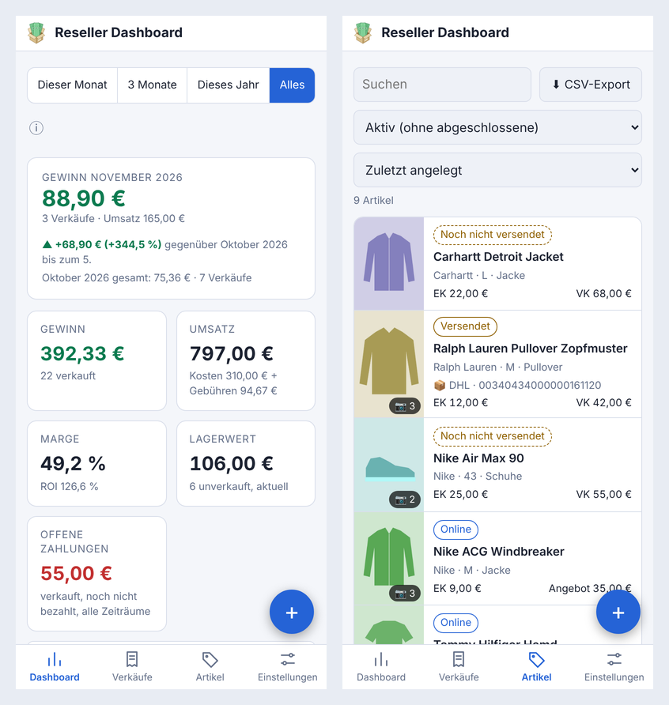
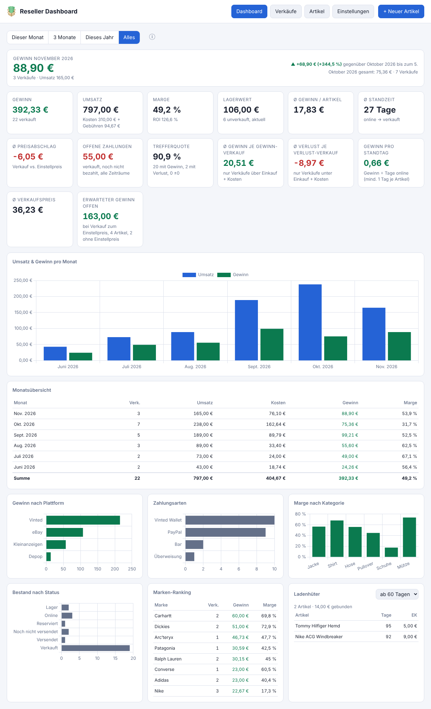
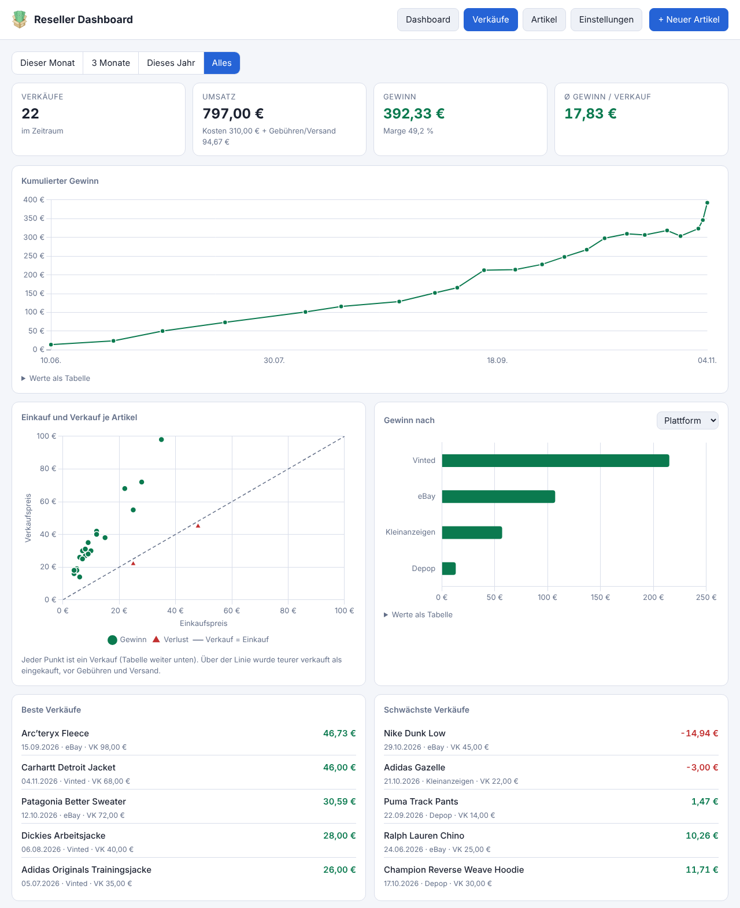
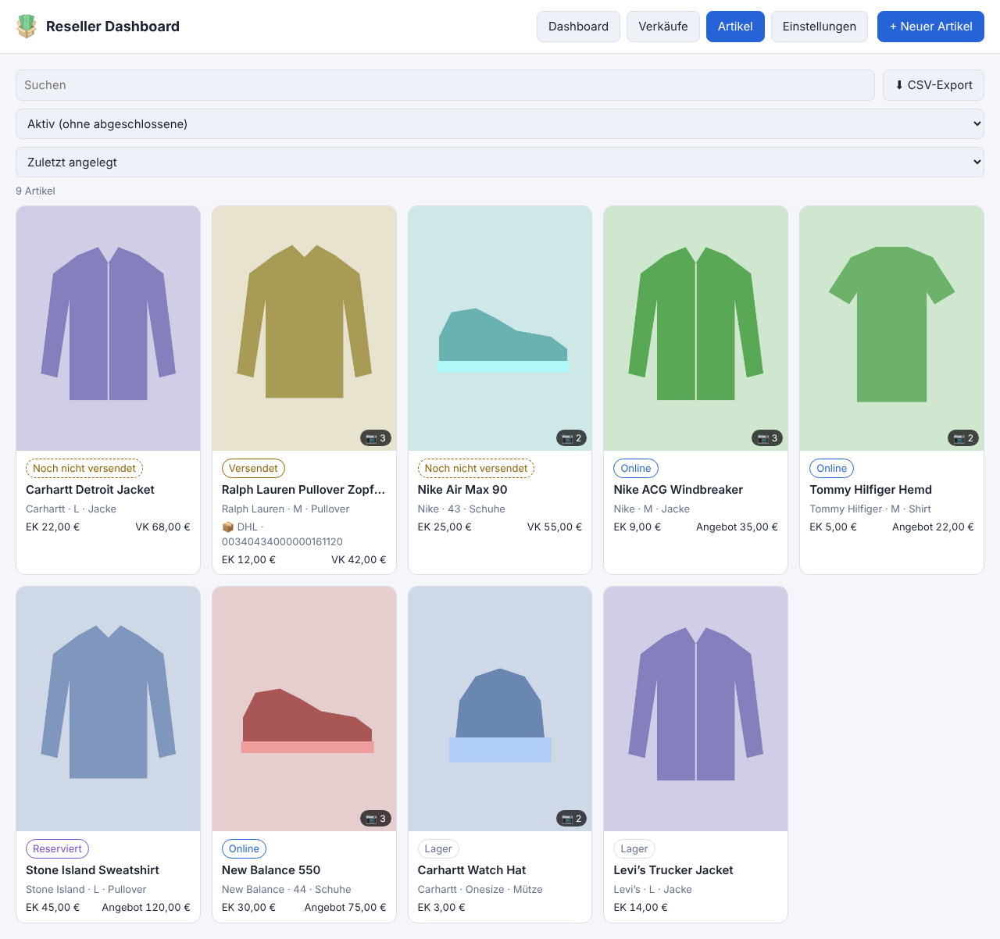

<p align="center">
  
</p>

<h1 align="center">Reseller-Dashboard</h1>

<p align="center"><b>English</b> · <a href="README.de.md">Deutsch</a></p>

<p align="center">
  Inventory management and finance dashboard for resellers,<br>
  from purchase, photos and shipping all the way to your profit per month.
</p>

<p align="center">
  <a href="https://github.com/MySquat516/Reseller-Dashboard/actions/workflows/test.yml"></a>
  <a href="https://github.com/MySquat516/Reseller-Dashboard/actions/workflows/docker.yml"></a>
  <a href="https://github.com/MySquat516/Reseller-Dashboard/actions/workflows/ios.yml"></a>
</p>

<p align="center">
  
</p>

---

If you resell clothes, sneakers and the like on the side, it is easy to lose track: What is still in stock,
what has sold but not shipped yet, and what is actually left after fees and postage?
The Reseller-Dashboard answers all of that in one place. It runs in your own homelab, so your data stays with you.

> **Language:** The app itself is in German (prices in euros, German number and date formats).
> This README is available in English and [German](README.de.md).

## Features

- **Items with everything you need:** title, description, size, category, brand, condition, notes and
  up to 60 photos per item (drag and drop, paste with Ctrl+V, or straight from the camera on a phone)
- **Status flow:** in stock → online → reserved → not shipped yet → shipped → sold
- **Sales and shipping:** platform, buyer, payment method and status, fees, shipping costs,
  tracking number with a tracking link, and shipping presets
- **Dashboard:** profit this month compared with last month, revenue, margin, ROI, time to sell, stock value,
  open payments, slow movers, and breakdowns by platform, payment method, category and brand
- **Sales view:** sortable table, best and worst sales, cumulative profit and purchase vs. sale price as charts
- **CSV export and import:** works with Excel, with a preview, error checks and duplicate detection
- **Backups:** full backup with one click, restore with an automatic safety copy, and a daily automatic backup
- **Made for phones:** runs as an app on your home screen, plus a native iOS app (work in progress)
- **Optional password protection** with a login that works with Face ID on the iPhone

## Screenshots

All screenshots show sample data, no real items and no real photos.

**Dashboard:** monthly profit, key figures, monthly overview, breakdowns and slow movers



<details>
<summary><b>Sales and items</b></summary>

**Sales:** cumulative profit, purchase vs. sale price per item, profit by group, best and worst sales.
Below that is the sortable table of all sales.



**Items:** list with status, photos, search, filters, sorting and CSV export.



</details>

## Quick start

Every push to `main` builds a ready-made image for `amd64` and `arm64`:
`ghcr.io/mysquat516/reseller-dashboard:latest`. On your server you only need the
[`docker-compose.yml`](docker-compose.yml):

```bash
docker compose pull      # get the new image
docker compose up -d     # start or update
```

The dashboard is then available at `http://<server>:3000`. To use another port, set it when starting,
for example `PORT=8080 docker compose up -d`. Updating is just these two commands. New database columns
are added automatically on start.

> **Private package?** Whether the server has to log in depends on the package visibility
> (GitHub → *Packages → reseller-dashboard → Package settings*). If it is private, run
> `docker login ghcr.io -u <github-user>` once. Use a personal access token (classic) with the
> `read:packages` scope as the password.

Each build is also tagged `sha-<commit>`, so you can go back to an older version (`image: …:sha-abc1234`).

<details>
<summary><b>Build it yourself or run without Docker</b></summary>

**Build it yourself:**

```bash
docker compose up -d --build
```

The build uses `network: host` (see `docker-compose.yml`) so that `npm ci` also works when DNS is unreliable
on your home network. To update, get the new version (`git pull` or unpack a new ZIP, keep the `data` folder)
and run `docker compose up -d --build`.

**Without Docker:** You need Node.js 20 or 22 (the tests run on these). For Node 24 there are no prebuilt
packages for the better-sqlite3 version in use, so `npm install` would have to compile it, which needs Python,
make and a C++ compiler.

```bash
npm install
npm start      # http://localhost:3000, data goes to ./data
npm test       # automated tests
```

</details>

## Configuration

Most settings live in the **Einstellungen** (settings) tab: default time range, slow-mover threshold
(7 to 365 days), an optional monthly goal and shipping presets. They apply to all devices.
For the container, these variables go under `environment:` in `docker-compose.yml`:

| Variable | Default | Meaning |
|---|---|---|
| `TZ` | `Europe/Berlin` | time zone |
| `APP_PASSWORD` | empty | turns on password protection |
| `APP_USER` | `admin` | user name for the login |
| `SESSION_DAYS` | `90` | how long a login stays valid |
| `SESSION_SECRET` | random | key for logins (default: value in `data/session-secret`) |
| `BACKUP_AUTO` | on | `0` turns off the daily backup |
| `BACKUP_KEEP` | `14` | how many days of automatic backups are kept |
| `BACKUP_DIR` | `<data folder>/backups` | another place for backups, for example a second disk |
| `MAX_RESTORE_MB` | `4096` | largest file allowed when restoring a backup |

All data (database `reseller.db` and images in `uploads/`) lives in the `./data` folder.

## What counts as a sale?

- **Reserved** does not count yet: The item is still unsold and stays in the stock value, but not among the slow movers.
- From **not shipped yet** onwards (and shipped and sold), an item with a sale price counts as a sale and goes into
  profit, revenue and breakdowns, regardless of the payment status. Unpaid sales also show up under "open payments".
- The month is based on the sale date, otherwise on the date the item was created.
- **Profit = sale price − purchase price − fees − shipping costs**

## In detail

<details>
<summary><b>All features</b></summary>

- **Photos:** up to 60 per item, reorder by dragging, choose the cover photo with a star, full-size view with
  arrow keys and swiping. Large photos are scaled down to at most 1800 px in the browser before uploading.
- **Item list:** sorting (newest/oldest first, title A–Z, purchase price, longest in stock; your choice is
  remembered) and search with several words in any order across title, brand, size, category, condition,
  description, platform, buyer, notes and tracking number. The number of matches is shown above the list.
  By default the list only shows active items, sold items are available through the filter.
- **Create as copy:** creates a copy including photos (handy for several identical pieces). Status, sale and
  shipping details stay empty.
- **Prices:** purchase price, listing price, sale price, fees, shipping costs and the matching dates
- **Shipping:** carrier, tracking number with a tracking link (DHL, Deutsche Post, Hermes, DPD, GLS, UPS) and
  shipping presets (carrier and price) that fill in carrier and shipping costs on the item
- **Dashboard** with a time range switch (this month, 3 months, this year, all): profit, revenue, margin, ROI,
  time to sell, price reduction and breakdowns by platform, payment method, category and brand
- **Extra key figures** for the chosen range: hit rate, average profit per profitable sale and average loss per
  losing sale, profit per day in stock, average sale price and expected profit of open items
  (if sold at the listing price)
- **Month tile:** profit of the current month compared with the previous month up to the same day
- **Monthly overview** as a chart and table, including months without sales
- **Always current, regardless of the time range:** stock value, inventory, open payments and slow movers
  (threshold adjustable, default 60 days)
- **Sales view:** sortable table with a totals row, search and platform filter, best and worst sales.
  Clicking a row opens the item.
- **Analysis charts:** cumulative profit over time, scatter chart of purchase vs. sale price per item
  (profit as a circle, loss as a triangle, line "sale = purchase") and profit by platform, category or brand.
  The values for the timeline and groups are also available as a table.
- **CSV export** (UTF-8, semicolon, decimal comma): all, only sold or only unsold items, optionally for a
  time range (sale or purchase date)
- **Form hint** when the sale date is before the "online since" date

</details>

<details>
<summary><b>Backup and restore</b></summary>

In the **Einstellungen → Daten & Backup** tab:

- **Download backup:** a ZIP file with the database and all photos. It reflects the moment you click and is
  consistent even while the app is running.
- **Restore backup:** replaces all items, photos, shipping presets and settings with the contents of a ZIP file.
  A single `.db` file works too, for example an automatic backup, in which case the photos stay as they are.
  Before that, the server automatically creates a **safety copy of the current state including photos**
  (`backups/pre-restore-….zip`, the last 2 are kept). If the file is invalid or damaged, nothing is changed.
  Backups from older versions work as well.
- **Automatic backup:** Once a day the database (without photos) is copied to `backups/auto-YYYY-MM-DD.db`,
  the last 14 days are kept. This protects against mistakes, but not against a disk failure, because the folder
  is on the same data volume. So download a full backup now and then, or back up `./data` externally as well.

If you copy `./data` by hand, stop the container first (`docker compose stop`). The database runs in WAL mode,
and a copy taken while the app is running can miss the latest changes or be incomplete.

For security, the container does not run as root but as the user `node`. On the first start after an update it
changes the owner of `./data` to that user automatically, which can take a moment with many photos.
`docker ps` shows whether the app is healthy (status `healthy`), using `/healthz`.

</details>

<details>
<summary><b>Password protection</b></summary>

Without `APP_PASSWORD` the app has no login. In that case only run it on your home network or over a VPN.
To turn it on, add this under `environment:` in `docker-compose.yml`:

```yaml
      APP_PASSWORD: a-long-password
      # APP_USER: admin          # user name, default: admin
```

Every page then shows a login page first. A login stays valid for 90 days (cookie or token) until you log out
under Einstellungen → Sicherheit or change the password, which logs out everywhere.

- **Face ID on the iPhone:** The login page is a normal form. If you save the credentials in the iPhone password
  manager, Safari fills them in after a Face ID check.
- After 5 wrong attempts the server blocks logins for 5 minutes. The password is compared in constant time.
- Without HTTPS, password and cookie travel over the network in plain text (inside a WireGuard VPN they are
  encrypted). Behind an HTTPS proxy the cookie automatically gets the `Secure` flag (header `X-Forwarded-Proto`).
- Only the login page, `/healthz`, the logo and the icons stay public.
- For scripts and apps: `POST /api/login` with `{"username": …, "password": …}` returns a cookie and a token
  that can be sent as `Authorization: Bearer <token>`.
- The iOS app cannot log in yet (planned together with the Face ID lock). Until then, only turn on password
  protection if you do not use the iOS app.

</details>

<details>
<summary><b>Use it as an app on your phone</b></summary>

The web interface is designed for phones and can be added to your home screen like an app:

- **iPhone (Safari):** share icon → "Add to Home Screen". The app then opens full screen.
- **Android (Chrome):** menu → "Add to Home screen". Chrome only offers it as a fully installed app over HTTPS.

This also works over plain HTTP (`http://<server-ip>:3000`). There is no offline mode, the app always needs a
connection to the server. When you are away, connect to your home network via VPN (e.g. WireGuard) first and
then open the same address.

**iOS app:** The [`ios/`](ios/README.md) folder contains a native SwiftUI app for iPhone and iPad that uses the
same API. The data stays on the server. So far it has the item list with search and filters as well as creating,
editing and deleting items. Photos, dashboard, shipping presets and CSV will follow. Setup with Xcode and
XcodeGen is described in [`ios/README.md`](ios/README.md).

</details>

<details>
<summary><b>CSV import: columns and formats</b></summary>

Available under **Einstellungen → "Artikel aus CSV importieren"**. It reads lists from Excel, Numbers or Google
Sheets as well as the app's own CSV export. First you get a preview with errors (row numbers as in Excel) and
hints, nothing is saved until you confirm. Delimiter (semicolon, comma, tab) and encoding (UTF-8, Excel "ANSI",
UTF-16) are detected automatically. Possible duplicates (same title, purchase price and purchase date as an
existing item) can be skipped, so importing the same file twice is safe. A template is available via a button.

The first row contains the column names, only "Titel" (title) is required. Upper and lower case, hyphens and
umlauts do not matter. The import currently recognizes **German column names** (with common alternatives):

| Field | Column name (alternatives) |
|---|---|
| Title | Titel (Artikel, Bezeichnung, Name, Produkt) |
| Description, size, category, brand, condition | Beschreibung, Größe (Size), Kategorie, Marke (Brand/Hersteller), Zustand |
| Status | Status: Lager, Online, Reserviert, Noch nicht versendet (zu versenden, gekauft), Versendet, Verkauft |
| Purchase price, purchase date | Einkaufspreis (EK, Kaufpreis) · Gekauft am (Kaufdatum, Einkaufsdatum) |
| Listing price, online since | Einstellpreis (Angebotspreis) · Online seit (Eingestellt am) |
| Sale price, sale date | Verkaufspreis (VK, VK-Preis, Erlös) · Verkauft am (Verkaufsdatum) |
| Platform, buyer, payment method, payment status | Plattform (Marktplatz) · Käufer (Kunde) · Zahlungsart (Zahlungsmethode) · Zahlungsstatus (bezahlt/offen) |
| Fees, shipping costs | Gebühren (Provision) · Versandkosten (Porto, Versand) |
| Carrier, tracking number, notes | Versandanbieter (Carrier) · Sendungsnummer (Tracking) · Notizen (Notiz, Bemerkung) |

Columns such as ID, profit and images (from the app's own export) are ignored, and so are unknown columns.
The preview lists them.

- **Numbers:** `12,50`, `12.5`, `1.234,56`, `1,234.56` and `12 €` all work. Negative amounts and more than two
  decimal places are reported as errors.
- **Dates:** `05.03.2026`, `5.3.26` and `2026-03-05` (also with a time). Invalid days such as 31 February are errors.
- **Empty status:** With a sale price it becomes "Verkauft" (sold), otherwise "Lager" (in stock).
- **Hints** (the import still works): status "Verkauft" without a sale price (does not count as a sale), sale price
  without a sold status, missing sale date (the import day counts instead), sale date before the purchase date.
- **Excel:** "Save as" → "CSV (comma delimited)" or "CSV UTF-8". An `.xlsx` file cannot be read, the app tells you so.
- The import only creates new items and never changes existing ones. Photos cannot be imported via CSV.

</details>

<details>
<summary><b>API</b></summary>

| Method | Path | Purpose |
|---|---|---|
| GET | `/api/items` | all items including images |
| GET | `/api/items/:id` | one item including images |
| POST | `/api/items` | create an item |
| PUT | `/api/items/:id` | update an item |
| POST | `/api/items/:id/duplicate` | create a copy: description, purchase details, listing price, notes and photos are copied, status `lager`, sale and shipping details empty; response `{ id, images, skippedImages }` |
| DELETE | `/api/items/:id` | delete an item and its images |
| POST | `/api/items/:id/images` | upload images (multipart, field `images`) |
| DELETE | `/api/images/:id` | delete a single image |
| PUT | `/api/items/:id/images/order` | save the image order |
| GET | `/api/stats?period=month\|3m\|year\|all&dead=7..365` | key figures for the dashboard (without `dead`: the setting is used) |
| GET | `/api/sales?period=month\|3m\|year\|all` | all sales in the range with profit, margin and time to sell |
| GET | `/api/export.csv` | items as CSV; optional `?scope=all\|sold\|unsold&by=sold\|purchase&from=YYYY-MM-DD&to=YYYY-MM-DD` (range inclusive, `by` is the date it refers to, default `sold`; invalid values → 400) |
| GET/POST | `/api/shipping-presets` | list / create shipping presets |
| PUT/DELETE | `/api/shipping-presets/:id` | update / delete a shipping preset |
| POST | `/api/login` | log in (only with `APP_PASSWORD`): cookie and token |
| POST | `/api/logout` | log out |
| GET | `/api/session` | `{auth, user}`: whether password protection is on and who is logged in |
| GET | `/api/backup` | download a full backup (ZIP with database and photos) |
| POST | `/api/restore` | restore a backup (multipart, field `backup`: ZIP or `.db`), replaces all data |
| GET | `/api/backups` | list of backups in the `backups` folder (automatic and before restoring) |
| GET | `/api/backups/:name` | download one of these backups |
| POST | `/api/import.csv` | import items from CSV; the body is the file as text (`Content-Type: text/csv`, max. 5 MB and 5000 rows). `?dry=1` only checks and creates nothing (preview), `?skipDuplicates=0` also imports possible duplicates. Response: recognized columns, number of valid rows/duplicates/errors, errors and hints with row numbers, sample rows |
| GET/PUT | `/api/settings` | read / change settings (`default_period`, `dead_days`, `monthly_goal`; PUT also accepts single fields) |
| GET | `/healthz` | health check for Docker (`{ok: true}`), reachable without login even with password protection |

</details>

<details>
<summary><b>Tests</b></summary>

`npm test` runs the automated tests (`node --test`, no extra packages, about 12 seconds).

The server tests start the **real server** (`node server.js`) for each test file on a free port with an empty
temporary data folder and talk to it over HTTP. Your real data in `data/` is never touched.

| File | Checks |
| --- | --- |
| `test/items.test.js` | items (create, update, validation, broken JSON), copying, shipping presets, settings, photo upload (file header check, order, deletion) |
| `test/stats.test.js` | key figures and sales list with a fixed data set: profit, time ranges, month list, slow movers, sales without date or price |
| `test/exportimport.test.js` | CSV export (format, selection, formula protection), CSV import via the API, round trip export → import |
| `test/backup.test.js` | backup ZIP, restore (including old versions, broken and malicious ZIPs), automatic backup |
| `test/auth.test.js` | password protection: locked routes, login, token, expiry, brake on failed attempts, redirects |
| `test/csvimport.test.js` | import logic on its own (numbers, dates, delimiters, encodings) |
| `test/packaging.test.js` | the Docker image contains all server files, dependencies and frontend scripts without name clashes |

Helpers (starting the server, test images, ZIP files) live in `testlib/`, not in `test/`, because `node --test`
runs every file in `test/` as a test. The GitHub Action `.github/workflows/test.yml` runs the tests on every push
and pull request with Node 20 (as in the Docker image) and Node 22.

Not tested automatically: the web interface in the browser (checked by hand) and the iOS app (separate workflow `ios.yml`).

</details>

## Project layout

| Part | Contents |
|---|---|
| `server.js` | Express server, API and database (SQLite via better-sqlite3) |
| `auth.js`, `backup.js`, `csvimport.js` | password protection, backups, CSV import |
| `public/` | web interface in vanilla JS with Chart.js, icons and manifest for the home screen |
| `ios/` | native SwiftUI app for iPhone and iPad |
| `test/`, `testlib/` | automated tests and helpers |

---

<sub>This app was built with the help of AI (Claude by Anthropic). The idea, requirements and tests come from
the project owner, the code was written with AI assistance. Please review it yourself before using it in production.</sub>
