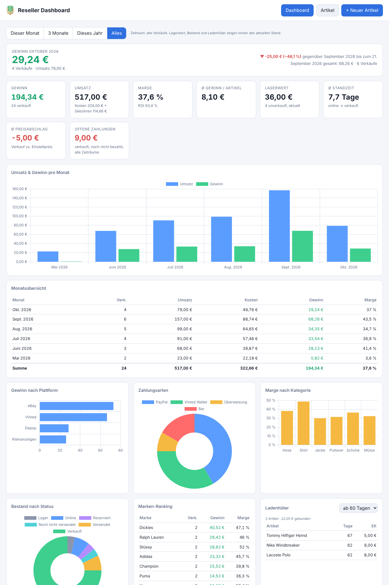
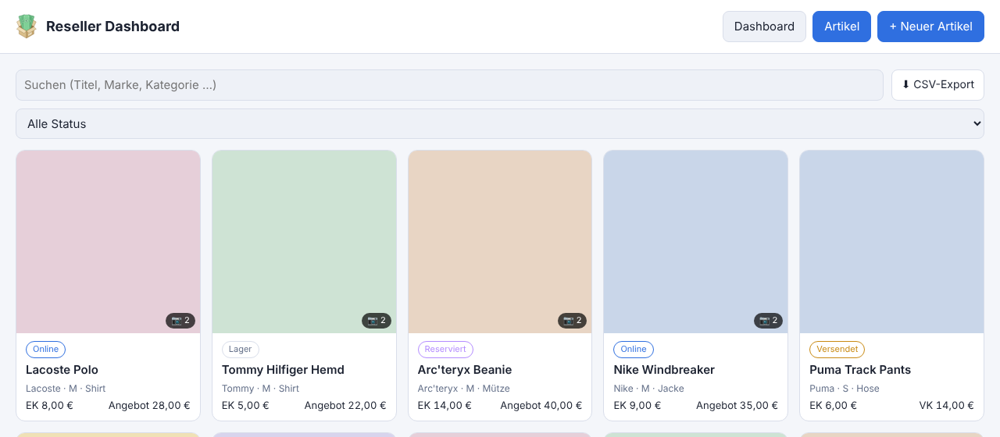

# Reseller Dashboard

Artikelverwaltung mit Bild-Upload und Finanz-Dashboard für Reseller.
Stack: Node.js, Express, SQLite (better-sqlite3), Chart.js, Vanilla-JS-Frontend.

> **Hinweis:** Diese App wurde mit Hilfe von KI (Claude von Anthropic) entwickelt.
> Idee, Anforderungen und Tests kommen vom Projektinhaber, der Code wurde KI-gestützt geschrieben.
> Bitte vor dem produktiven Einsatz selbst prüfen.

## Oberfläche

Beispieldaten, keine echten Artikel.





## Starten mit Docker

```bash
docker compose up -d --build
```

Danach erreichbar unter `http://<server>:3000`.

Der Build läuft mit `network: host` (siehe `docker-compose.yml`), damit `npm install` im Docker-Build
auch bei DNS-Problemen im Heimnetz funktioniert. Es wird kein fertiges Image aus einer Registry geladen,
das Image wird lokal aus dem `Dockerfile` gebaut.

**Update:** neuen Stand holen (`git pull` oder neues ZIP entpacken, den Ordner `data` behalten) und
`docker compose up -d --build` ausführen. Neue Datenbankspalten werden beim Start automatisch ergänzt.

Alle Daten (Datenbank `reseller.db` und Bilder in `uploads/`) liegen im Ordner `./data`.
Backup = diesen Ordner kopieren.

## Starten ohne Docker

```bash
npm install
npm start
```

## Als App auf dem Handy nutzen

Die Weboberfläche ist für Handys ausgelegt und lässt sich wie eine App auf den Homescreen legen:

- **iPhone (Safari):** Teilen-Symbol → „Zum Home-Bildschirm". Danach öffnet sich die App im Vollbild.
- **Android (Chrome):** Menü → „Zum Startbildschirm hinzufügen". Als vollständig installierte App bietet
  Chrome das nur über HTTPS an.

Das funktioniert auch über reines HTTP (`http://<server-ip>:3000`). Ohne HTTPS bleibt der Service Worker
inaktiv, die App braucht dann immer eine Verbindung zum Server (kein Offline-Betrieb).

Von unterwegs: erst per VPN (z. B. WireGuard) ins Heimnetz verbinden und dann dieselbe Adresse öffnen.
Der Datenverkehr ist durch das VPN verschlüsselt. Die App hat keinen eigenen Login und gehört nicht
ungeschützt ins Internet.

## Funktionen

- Artikel mit Titel, Beschreibung, Größe, Kategorie, Marke, Zustand und Notizen
- Bis zu 60 Bilder pro Artikel: Drag-and-drop, Einfügen per Strg+V oder Auswählen (am Handy auch direkt Kamera),
  Sortieren per Ziehen, Titelbild per Stern, Großansicht mit Pfeiltasten und Wischen.
  Große Fotos werden vor dem Upload im Browser auf max. 1800 px verkleinert (spart Speicher und Zeit).
- Status-Ablauf: Lager → Online → Reserviert → Noch nicht versendet → Versendet → Verkauft (abgeschlossen).
  Die Artikelliste zeigt standardmäßig nur aktive Artikel, abgeschlossene („Verkauft") sind über den Filter erreichbar.
- Preise: Einkauf, Einstellpreis, Verkaufspreis, Gebühren, Versandkosten, Daten
- Verkaufsdetails: Plattform, Käufer, Zahlungsart, Zahlungsstatus
- Versand: Anbieter, Sendungsnummer mit Tracking-Link (DHL, Deutsche Post, Hermes, DPD, GLS, UPS) und
  Versandvorlagen (Anbieter + Preis), die Anbieter und Versandkosten im Artikel ausfüllen
- CSV-Export aller Artikel (Excel-tauglich: UTF-8, Semikolon, Dezimalkomma) über den Button in der Artikelliste
- Dashboard mit Zeitraum-Schalter (Dieser Monat, 3 Monate, Dieses Jahr, Alles):
  Gewinn, Umsatz, Marge, ROI, Standzeit, Preisabschlag, Auswertung nach Plattform, Zahlungsart, Kategorie und Marke
- Monatskachel: Gewinn des aktuellen Monats im Vergleich zum Vormonat bis zum gleichen Tag
- Monatsübersicht als Diagramm und Tabelle (inkl. Monate ohne Verkäufe)
- Immer aktuell, unabhängig vom Zeitraum: Lagerwert, Bestand, offene Zahlungen und Ladenhüter
  (Grenze wählbar: 30, 60 oder 90 Tage)
- Formularhinweis, wenn „Verkauft am" vor „Online seit" liegt

## Was zählt als Verkauf?

- **Reserviert** zählt noch nicht: Der Artikel gilt als unverkauft und bleibt im Lagerwert, aber nicht bei den Ladenhütern.
- Ab **Noch nicht versendet** (sowie Versendet und Verkauft) zählt ein Artikel mit eingetragenem Verkaufspreis
  als Verkauf und geht in Gewinn, Umsatz und Auswertungen ein, unabhängig vom Zahlungsstatus.
  Noch nicht bezahlte Verkäufe stehen zusätzlich bei „Offene Zahlungen".
- Der Monat richtet sich nach „Verkauft am", ersatzweise nach dem Anlegedatum.
- Gewinn = Verkaufspreis − Einkaufspreis − Gebühren − Versandkosten.

## Hinweis

Die App hat keinen Login. Betreibe sie nur im Heimnetz oder hinter einem Reverse Proxy mit Authentifizierung
(z. B. Authelia, Basic Auth in Nginx Proxy Manager oder Traefik).

## API

| Methode | Pfad | Zweck |
|---|---|---|
| GET | `/api/items` | alle Artikel inkl. Bilder |
| POST | `/api/items` | Artikel anlegen |
| PUT | `/api/items/:id` | Artikel ändern |
| DELETE | `/api/items/:id` | Artikel samt Bildern löschen |
| POST | `/api/items/:id/images` | Bilder hochladen (multipart, Feld `images`) |
| DELETE | `/api/images/:id` | einzelnes Bild löschen |
| PUT | `/api/items/:id/images/order` | Bildreihenfolge speichern |
| GET | `/api/stats?period=month\|3m\|year\|all&dead=30\|60\|90` | Kennzahlen fürs Dashboard |
| GET | `/api/export.csv` | alle Artikel als CSV |
| GET/POST | `/api/shipping-presets` | Versandvorlagen auflisten / anlegen |
| PUT/DELETE | `/api/shipping-presets/:id` | Versandvorlage ändern / löschen |
